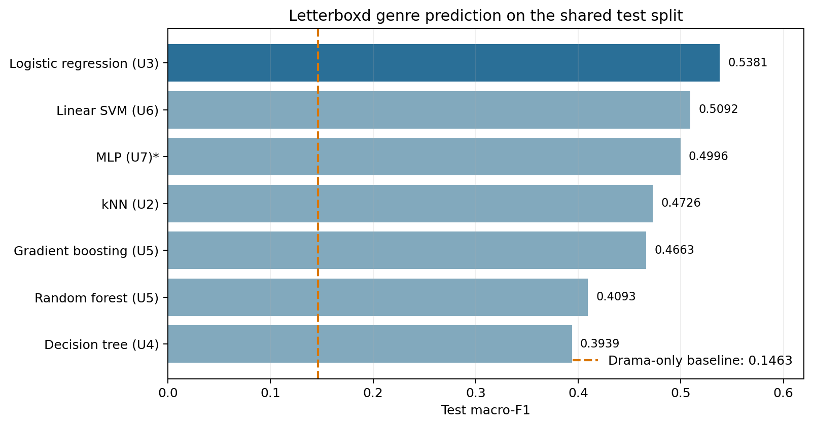

# Movie Genre Predictor

[Open the live Movie Genre Predictor](https://movie-genreprediction-ai.onrender.com/)

## Project overview

This project predicts movie genres from film descriptions. Given a description, it estimates whether the film belongs to each of five genres: **Action, Comedy, Drama, Horror, and Romance**.

This is a **multi-label classification** task. A film can belong to several of these genres at once, so the model can return more than one predicted genre. The application also shows a score for every genre, making it possible to compare model choices on the same description.

The work grew out of the weekly BIL/YAP 470 assignments. It applies the methods studied in U2–U8 to one fixed Letterboxd dataset, compares their results, and provides a small web interface for trying the saved models.

## Dataset

The project uses the [Letterboxd Movies Dataset on Kaggle](https://www.kaggle.com/datasets/gsimonx37/letterboxd), version 2 as recorded for the course project. The working sample contains 10,000 films selected from eligible records after joining movie descriptions and genres by film ID, removing empty descriptions and exact duplicate descriptions, and retaining films with at least one of the five target genres.

| Genre label | Films in the sample | Share of sample |
|---|---:|---:|
| Action | 1,071 | 10.71% |
| Comedy | 3,225 | 32.25% |
| Drama | 5,730 | 57.30% |
| Horror | 1,428 | 14.28% |
| Romance | 1,326 | 13.26% |

Labels overlap, so the counts add up to more than 10,000. The dataset uses a fixed split of **7,020 training films, 1,490 validation films, and 1,490 test films**, with random seed `470`. The raw Kaggle CSV files are not included in this repository.

## Modeling approach

Film descriptions are converted to numeric features with unigram TF-IDF: up to 1,000 features, `min_df=2`, lowercase text, and L2 row normalization. For U2–U5, PCA reduces these features to 704 components. U6–U8 use the original TF-IDF representation.

The project compares these methods:

| Week | Method | Selected configuration |
|---|---|---|
| U2 | Distance-weighted k-nearest neighbors | `k=201`; PCA features |
| U3 | One-vs-rest logistic regression | L2 regularization; PCA features |
| U4 | One-vs-rest decision tree | Entropy, `max_depth=5`; PCA features |
| U5 | Random forest | 200 trees, `max_features=sqrt`; PCA features |
| U5 | Histogram gradient boosting | Learning rate `0.1`, 200 iterations; PCA features |
| U6 | One-vs-rest linear SVM | `C=0.1`, balanced class weights; raw TF-IDF |
| U7 | PyTorch multilayer perceptron (MLP) | Hidden layers `[128, 64]`, dropout `0.2`, learning rate `0.001` |
| U8 | MLP configuration search | Four combinations of hidden size, dropout, and learning rate |

The U8 assignment also covers CNNs for image data. Since this project uses text, it compares MLP configurations instead of applying a CNN to the descriptions.

Models produce a score for each genre. A decision threshold is selected on the validation split to maximize macro-F1; the test split is not used to choose thresholds. In the web app and command-line output, a genre is marked positive when its score reaches that model's saved threshold. The five labels are evaluated independently, so zero, one, or several may be predicted.

## Evaluation and results

**Macro-F1** is the primary metric. It gives each genre equal weight, which matters because the labels are imbalanced: Drama appears in 57.30% of the sample, while Action appears in 10.71%.

The following scores are the historical weekly results on the shared held-out test split:

| Week | Method | Test macro-F1 |
|---|---|---:|
| U2 | kNN | 0.4726 |
| U3 | Logistic regression | **0.5381** |
| U4 | Decision tree | 0.3939 |
| U5 | Random forest | 0.4093 |
| U5 | Gradient boosting | 0.4663 |
| U6 | Linear SVM | 0.5092 |
| U7 | MLP | 0.4996* |

An all-negative predictor has macro-F1 `0.0000`. Predicting only the most common label, Drama, gives `0.1463`. Logistic regression's `0.5381` is **0.3918 points higher**, about 3.68 times the Drama-only baseline. This shows that the descriptions contain useful genre signal on this split; it does not guarantee the same performance on new data.

\* The U7 course form recorded validation macro-F1 `0.5125`. The `0.4996` above is an additional evaluation on the shared test split. U8's best configuration was selected on validation data; no shared test score is reported for U8.

The saved model files in this repository have their own validation results in [`artifacts/model_registry.json`](artifacts/model_registry.json). These were freshly fitted for this model bundle and are **not** the historical test results above:

| Saved model | Validation macro-F1 |
|---|---:|
| U2 kNN | 0.5060 |
| U3 logistic regression | 0.5394 |
| U4 decision tree | 0.4236 |
| U5 random forest | 0.4279 |
| U5 gradient boosting | 0.4763 |
| U6 linear SVM | 0.5221 |
| U7 MLP | 0.5003 |
| U8 selected MLP | 0.5115 |



These scores describe one fixed split rather than a universal ranking. U2–U5 use PCA-reduced features, while U6–U7 use raw TF-IDF, so the comparison does not isolate the algorithm alone. Unigram TF-IDF also loses word order and context. Genre overlap and class imbalance make the task harder.

## Try the live application

Open the [live Movie Genre Predictor](https://movie-genreprediction-ai.onrender.com/), choose a model, and enter a film description. The result shows:

- The genres that pass the selected model's validation threshold
- The highest-scoring genre
- A score for each of the five genres
- The model's validation macro-F1 in the model selector

The scores next to model names are validation macro-F1 values, not test scores. SVM outputs are sigmoid-transformed decision scores and are not calibrated probabilities. The app does not save a conversation history.

## Run the application locally

Python 3.10 or later is required. From the repository root, install the dependencies and package:

```bash
python -m pip install -r requirements.txt
python -m pip install -e .
```

Start the local web interface:

```bash
python -m letterboxd_project.webapp --port 8765
```

Then open [http://127.0.0.1:8765](http://127.0.0.1:8765). The interface runs locally and keeps the current conversation in the page only; it does not write it to a history file.

## Use a saved model from the command line

Create a CSV with a required `description` column and an optional `id` column:

```csv
id,description
film-001,"A detective investigates a series of mysterious events in a small town."
film-002,"Two friends travel across the country and discover an unexpected romance."
```

For example, run logistic regression and save its results to `predictions.csv`:

```bash
python -m letterboxd_project.predict examples/sample_descriptions.csv --model u3_logistic_regression --artifacts artifacts --output predictions.csv
```

The output contains five score columns such as `Action_prob` and five binary prediction columns such as `Action_pred`. A film can have multiple positive genre predictions.

Available model keys are:

```text
u2_knn
u3_logistic_regression
u4_decision_tree
u5_random_forest
u5_gradient_boosting
u6_linear_svm
u7_mlp
u8_mlp_dropout0
u8_mlp_dropout02
u8_mlp_large
u8_mlp_lr0005
u8_selected_mlp
```

`u8_selected_mlp` selects the U8 configuration with the best validation macro-F1. Each model's threshold and validation metrics are stored in `artifacts/model_registry.json`.

## Use the prediction function in Python

```python
from letterboxd_project.predict import predict

descriptions = [
    "A detective investigates a series of mysterious events in a small town.",
    "Two friends travel across the country and discover an unexpected romance.",
]

predictions, probabilities = predict(
    descriptions,
    model_name="u3_logistic_regression",
    artifact_dir="artifacts",
)

print(predictions)   # DataFrame with *_prob and *_pred columns
print(probabilities) # Columns ordered: Action, Comedy, Drama, Horror, Romance
```

## Retrain the models

The raw data is excluded from this repository. Download `movies.csv` and `genres.csv` from the [Kaggle dataset](https://www.kaggle.com/datasets/gsimonx37/letterboxd) and place them here:

```text
data/raw/movies.csv
data/raw/genres.csv
```

The fixed ID split is stored in `data/splits/letterboxd_split_u5.csv`. Reproduction requires source data whose film IDs and descriptions match the version used to create that manifest. Train all weekly models and run the four-setting U8 MLP search with:

```bash
python -m letterboxd_project.train_all --data-dir data/raw --split-manifest data/splits/letterboxd_split_u5.csv --output artifacts --with-u8-search
```

The training script uses seed `470`. TF-IDF and PCA are fit on the training split only. Model settings and decision thresholds are selected on the validation split. The script does not use test labels for fitting or threshold selection. It writes model files, preprocessing objects, and validation metrics under `artifacts/`; use a different `--output` directory to preserve the current files.

## Repository contents

```text
artifacts/       Saved models, TF-IDF/PCA objects, and model registry
data/splits/     Fixed film-ID split; no raw film descriptions
examples/        Small example input CSV
figures/         Test macro-F1 comparison chart
src/             Prediction and training code
web/             Web interface HTML, CSS, and JavaScript
REPORT.md        Full comparison, baselines, interpretation, and limitations
```

## Data and code licensing

The course project recorded the Kaggle dataset as GPL-3. Check the current dataset page and its terms before redistributing data. The raw CSV files are not included here.

This repository does not currently include a separate open-source license for its code or trained model files. Until a license is added, do not assume that the project code or weights are licensed for reuse. The dataset license and this repository's code license are separate.
