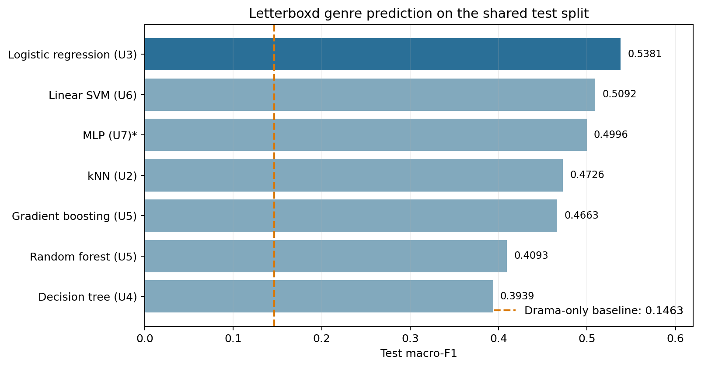

# Letterboxd film genre prediction: weekly comparison

## Problem and data

The task predicts whether a film belongs to each of five genres—Action, Comedy, Drama, Horror, and Romance—from its description. Labels overlap: a film may have more than one genre. The working sample contains 10,000 films selected with seed 470 from 353,277 eligible records after linking `movies.csv` and `genres.csv` by film ID, removing empty and exact-duplicate descriptions, and requiring at least one of the five labels.

| Label | Positive films | Sample proportion |
|---|---:|---:|
| Action | 1,071 | 10.71% |
| Comedy | 3,225 | 32.25% |
| Drama | 5,730 | 57.30% |
| Horror | 1,428 | 14.28% |
| Romance | 1,326 | 13.26% |

The split is fixed across weeks: 7,020 train, 1,490 validation, and 1,490 test films. Macro-F1 is the primary metric because it gives the five labels equal weight. Model settings and thresholds were selected on validation data; the table reports the saved weekly test scores.

## Model comparison

### Fresh validation scores for the saved artifacts

The model files in this repository draft were freshly fitted on the training split and evaluated on validation. Their thresholds were selected on validation macro-F1. These numbers describe the saved artifacts' validation run; the historical test results below are separate.

| Artifact | Validation macro-F1 | Validation macro-AUC | Threshold |
|---|---:|---:|---:|
| U2 kNN | 0.5060 | 0.7368 | 0.16 |
| U3 logistic regression | 0.5394 | 0.7779 | 0.20 |
| U4 decision tree | 0.4236 | 0.6131 | 0.14 |
| U5 random forest | 0.4279 | 0.6555 | 0.15 |
| U5 gradient boosting | 0.4763 | 0.7190 | 0.09 |
| U6 linear SVM | 0.5221 | 0.7751 | 0.50 |
| U7 MLP | 0.5003 | 0.7665 | 0.46 |
| U8 best project MLP | 0.5115 | 0.7721 | 0.50 |

The U8 search selected hidden layers [128, 64], dropout=0.2, and learning rate=0.0005 among its four configurations. Its best epoch was 11, selected by validation loss with patience=4.

### Historical weekly held-out test results

| Week | Method | Representation and selected setting | Test macro-F1 |
|---|---|---|---:|
| U2 | kNN | TF-IDF 1,000 → PCA 704; k=201, distance weights; threshold 0.16 | 0.4726 |
| U3 | Logistic regression | TF-IDF 1,000 → PCA 704; L2, lambda=0.0001; threshold 0.20 | **0.5381** |
| U4 | Decision tree | TF-IDF 1,000 → PCA 704; depth=5; threshold 0.13 | 0.3939 |
| U5 | Random forest | PCA 704; 200 trees, max_features=sqrt; threshold 0.14 | 0.4093 |
| U5 | Gradient boosting | PCA 704; learning rate=0.1, 200 iterations; threshold 0.05 | 0.4663 |
| U6 | Linear SVM | Raw 1,000 unigram TF-IDF; C=0.1, balanced class weights; threshold 0.50 | 0.5092 |
| U7 | MLP | Raw 1,000 unigram TF-IDF; hidden=[128,64], dropout=0.2, lr=0.001; threshold 0.46 | 0.4996* |

\* U7's course form recorded validation macro-F1=0.5125. The report's 0.4996 is an additional evaluation on the common held-out test split.

## Baselines and interpretation

A zero-positive predictor has macro-F1 0.0000. Predicting only the most frequent label, Drama, has macro-F1 0.1463. Logistic regression's 0.5381 is **+0.3918 points** above Drama-only, or about **3.68×** its macro-F1. That supports the conclusion that the descriptions contain useful genre signal; it does not establish statistical superiority on other samples.

Logistic regression had the strongest reported test score. The linear SVM and MLP were also competitive, while the tree and random forest were weaker. The U2 scaling ablation showed that extra MinMax scaling reduced validation macro-F1 from 0.1620 (no extra scaling) to 0.0221; the final text pipeline therefore retained TF-IDF's L2 row normalization without extra column scaling. The decision tree's unlimited-depth validation macro-AUC was 0.5320, while depth 5 reached 0.6210, so depth was selected using validation rather than training accuracy.

The scores do not isolate the algorithm alone: U2-U5 used PCA-reduced features while U6-U7 used raw TF-IDF. Unigram TF-IDF also loses word order and context; descriptions can be ambiguous, label frequencies are imbalanced, and genres overlap. Results come from one fixed split, so the ranking is descriptive rather than a claim of universal performance.

## Reproducibility note

The model package is retrained from the recorded settings using only the 7,020 training films. It includes its own validation metrics and validation-selected thresholds in `artifacts/model_registry.json`. Historical test scores above come from the weekly course records and are kept separate from the fresh artifact validation scores. No test labels are used by the retraining script.
